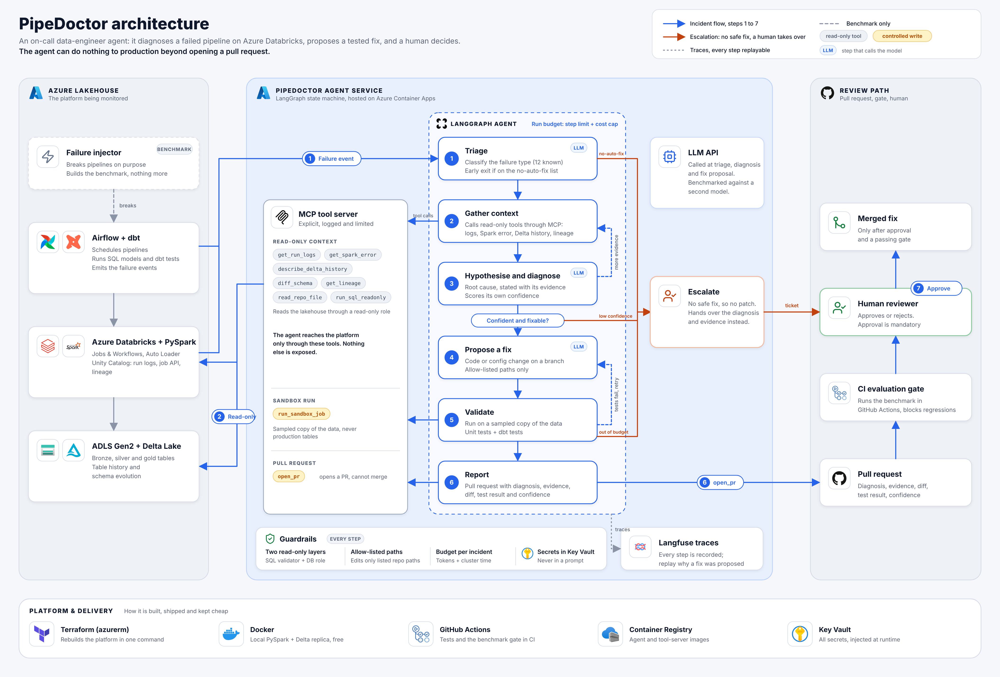

# PipeDoctor

An AI agent that acts as an on-call data engineer. When a Spark, Airflow or dbt pipeline fails on
Azure Databricks, it diagnoses the cause from logs, lineage and table history, then opens a tested
fix as a pull request that a human approves.

See `docs/technical-sheet-v2.pdf` for the full design.

## Layout
| Folder | What lives there |
|---|---|
| `docs/` | One-page brief, decision log, risk register, interview guide |
| `infra/` | Terraform (azurerm) for the Azure platform |
| `pipelines/` | PySpark, Auto Loader, dbt models, Airflow DAGs (the system being monitored) |
| `scenarios/` | The injected failures: repo change + data change + ground truth |
| `agent/` | LangGraph agent and MCP tool server |
| `benchmark/` | Benchmark runner, scoring, bootstrap statistics |
| `.github/workflows/` | CI: tests and the evaluation gate |

## Roadmap (8 weeks, 4 gates)
- [ ] **Phase 1, Foundations (sprints 1-2)**: interviews, one-page brief, Terraform for Azure, pipelines green locally and on Azure. **Gate 1**
- [ ] **Phase 2, Break it (sprints 3-4)**: failure injector (6 types), MCP tool server, agent v1, first PR for 3 failure types. **Gate 2: first demo**
- [ ] **Phase 3, Safe and measured (sprints 5-6)**: sandbox validation, guardrails, all 12 types, 50-60 scenarios, baselines, ablations, CI evaluation gate. **Gate 3**
- [ ] **Phase 4, Ship it (sprints 7-8)**: cost dashboard, postmortems, scorecard, Terraform deployment, README, recorded demo. **Gate 4**

## Where to look
| File | Purpose |
|---|---|
| `docs/sprint-plan.md` | The whole plan: 8 sprints, 33 steps, gates |
| `docs/sprints/` | One file per sprint: backlog, definition of done, review, retro |
| `docs/journal.md` | Dated log of every work session |
| `docs/guide/` | Technical documentation, updated at each doc checkpoint |
| `docs/decision-log.md`, `docs/risk-register.md` | Decisions and risks |

## Working rules
- Develop locally in Docker (free). Azure is for the demo and for learning the platform.
- Every major choice gets an entry in `docs/decision-log.md`.
- Every gate is a go/no-go recorded in the decision log.
- Every step ends with a journal entry; every 2-3 steps we write or update a page in `docs/guide/`.
